# Microsoft Sentinel Homelab: Initial Setup

This project documents the initial setup of a Microsoft Sentinel homelab using a local Windows 11 LTSC virtual machine.

The objective was to create a working telemetry pipeline from a Windows endpoint into Microsoft Sentinel while keeping the environment small, cost-conscious and suitable for later KQL, detection engineering and incident investigation projects.

---

## Environment Overview

The lab consists of:

- An Arch Linux virtualisation host
- A Windows 11 LTSC virtual machine running through KVM/QEMU
- Windows Security auditing
- PowerShell Script Block Logging
- Sysmon
- Azure Arc
- Azure Monitor Agent
- A Log Analytics workspace
- Microsoft Sentinel
- A minimal Windows Security Events Data Collection Rule

The completed telemetry path is:

```text
Windows security telemetry
        ↓
Azure Monitor Agent
        ↓
Data Collection Rule
        ↓
Log Analytics workspace
        ↓
Microsoft Sentinel
        ↓
KQL investigation
```

---

## Windows Telemetry Configuration

### Sysmon

Sysmon was installed to provide additional endpoint telemetry beyond the standard Windows Security log.

The installation was tested by launching Notepad and confirming that the process appeared in Event Viewer as Sysmon Event ID 1.

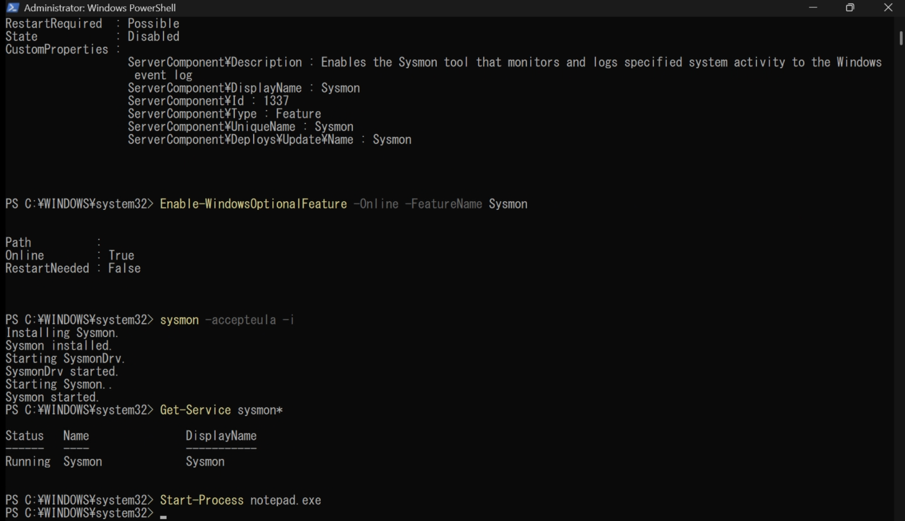

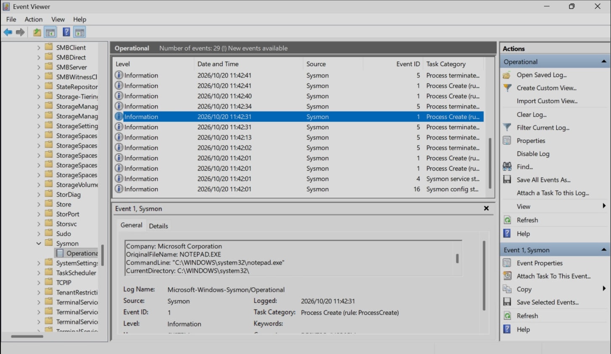

---

### Process Creation Auditing

Native Windows process-creation auditing was enabled to generate Security Event ID 4688.

Command-line process auditing was also enabled so that process arguments would be included in the generated events. This provides more useful information for later investigation and detection queries.

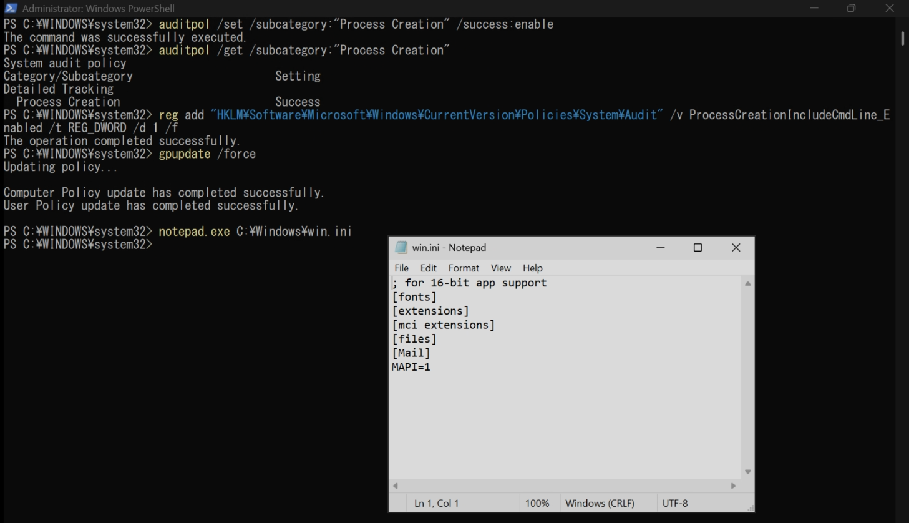

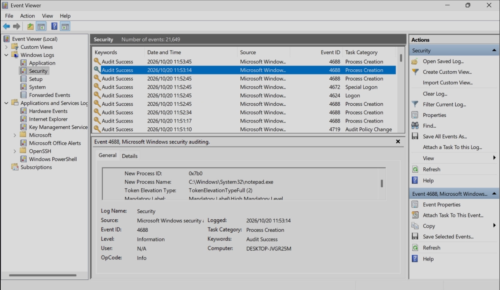

---

### PowerShell Script Block Logging

PowerShell Script Block Logging was enabled to record executed PowerShell content as Event ID 4104.

A controlled PowerShell command was executed and the resulting event was confirmed in the PowerShell Operational log.

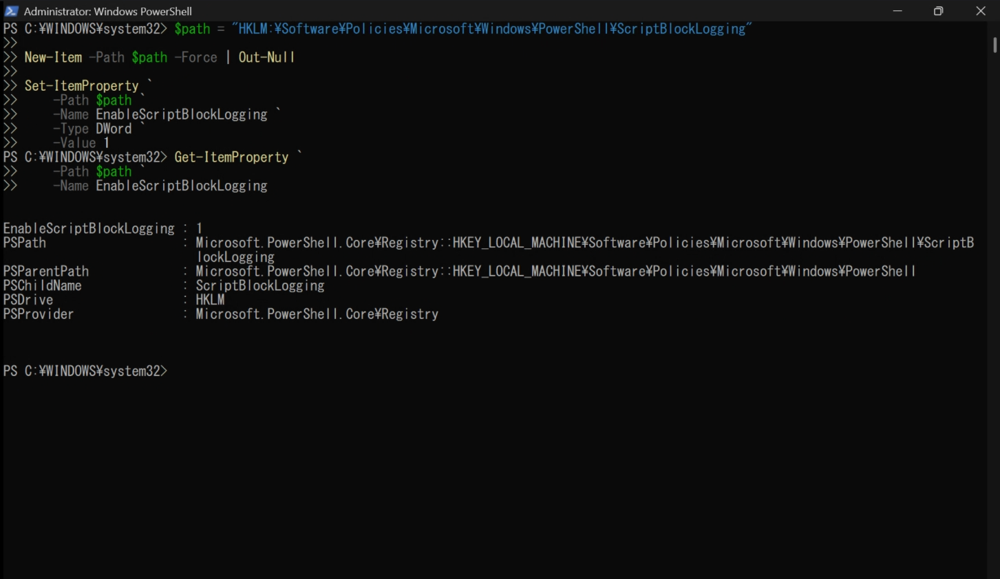

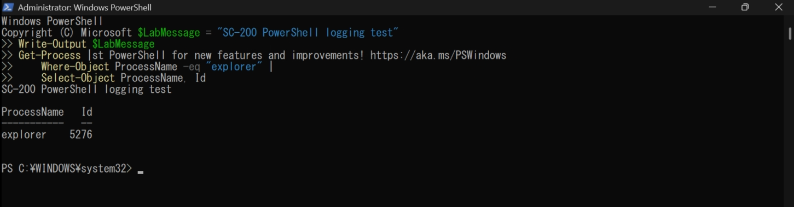

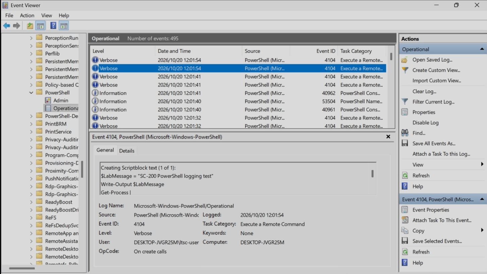

---

### Logon Auditing

Success and failure auditing was enabled for Windows logon activity.

A temporary local user account was created and an incorrect password was deliberately supplied to generate a controlled failed-logon event. The resulting Event ID 4625 was confirmed in Event Viewer.

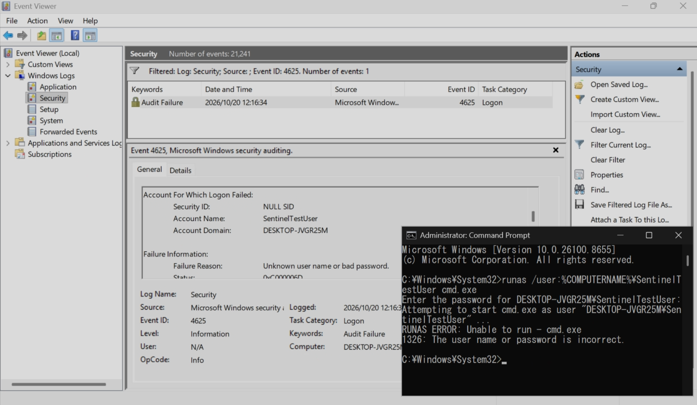

The temporary account was removed after the event-ingestion test was completed.

---

### VM Recovery Point

A virtual-machine snapshot was created after the local telemetry configuration was completed.

This provides a known working recovery point containing the Windows audit policy, PowerShell logging and Sysmon configuration.

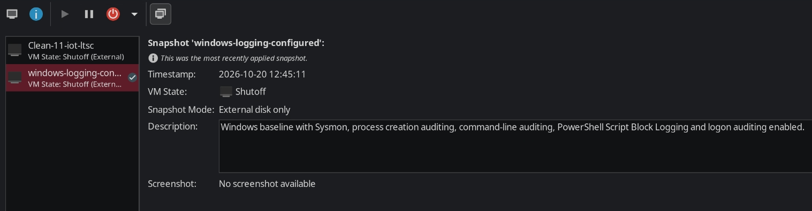

---

## Azure Foundation

### Azure Free Trial

The Azure environment was created using the 30-day Azure free trial.

The project was designed to remain within the trial allowances and avoid unnecessary resource deployment.

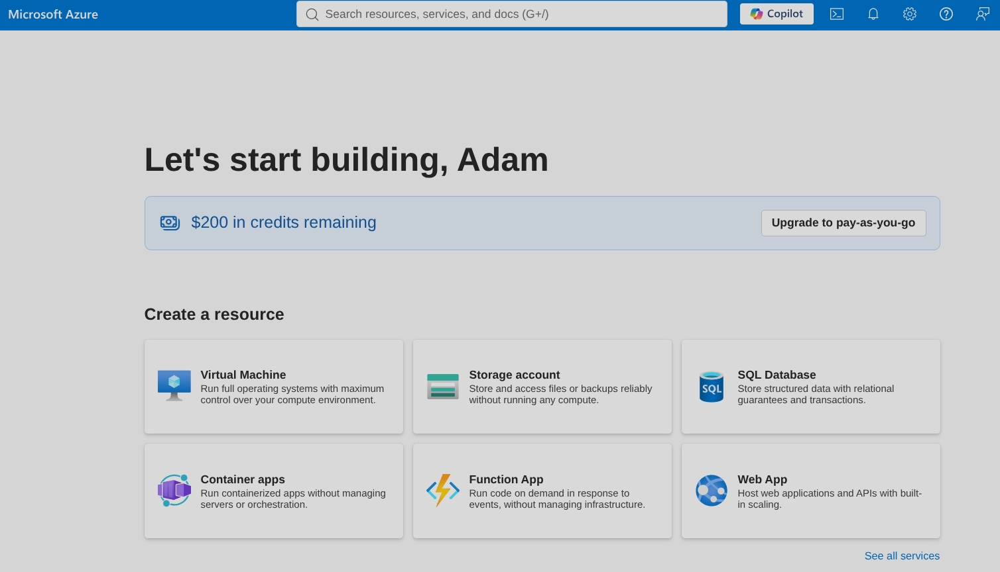

---

### Resource Group

A dedicated resource group named `rg-sentinel-homelab` was created to contain the Azure resources associated with the project.

Keeping the resources in one group also provides a straightforward way to remove the lab before the free trial expires.

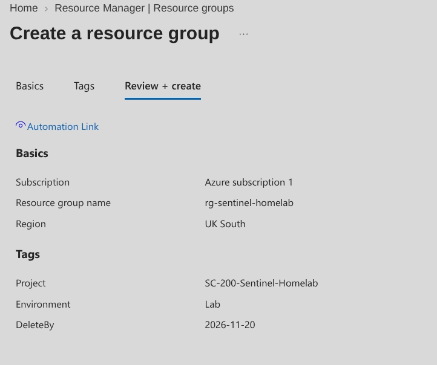

---

### Log Analytics Workspace

A Log Analytics workspace named `law-sentinel-homelab` was deployed in the UK South region.

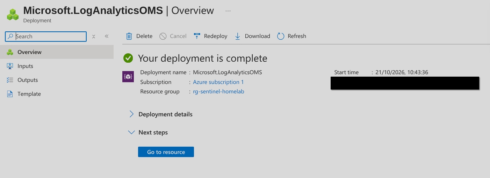

The workspace retained its default data-retention configuration because extended retention was not required for the temporary lab.

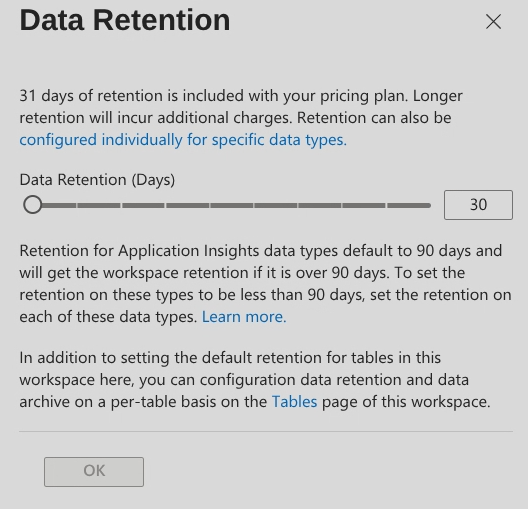

---

## Microsoft Sentinel Configuration

Microsoft Sentinel was enabled on the Log Analytics workspace.

The Microsoft Sentinel free trial was confirmed as active before any endpoint data was connected.

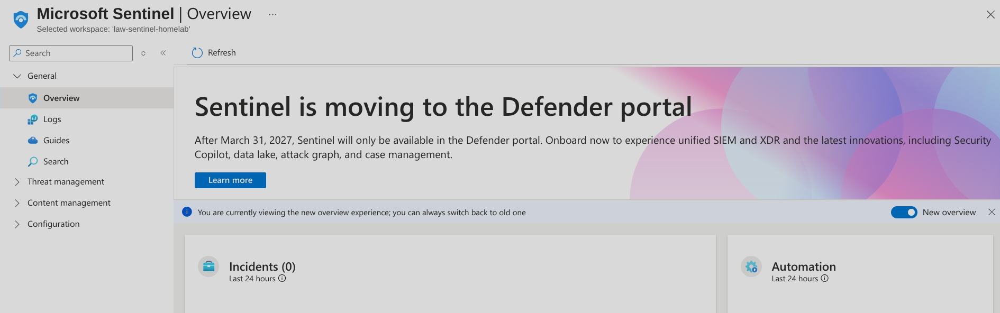

A daily ingestion cap of 0.5 GB was configured as an additional safeguard against unexpected data volume.

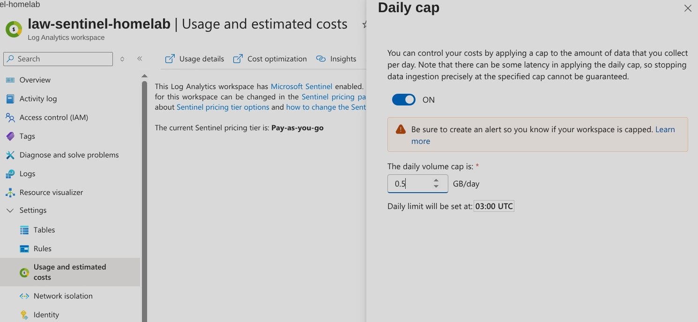

---

## Windows VM Onboarding

### Azure Arc

Because the Windows VM was hosted locally rather than in Azure, the machine was onboarded through Azure Arc.

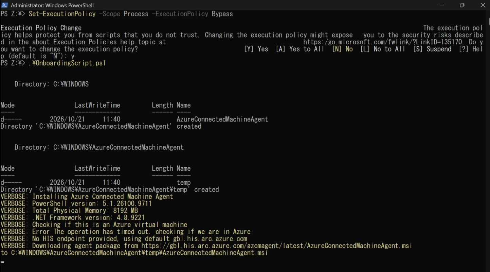

The machine was then verified as connected in Azure.

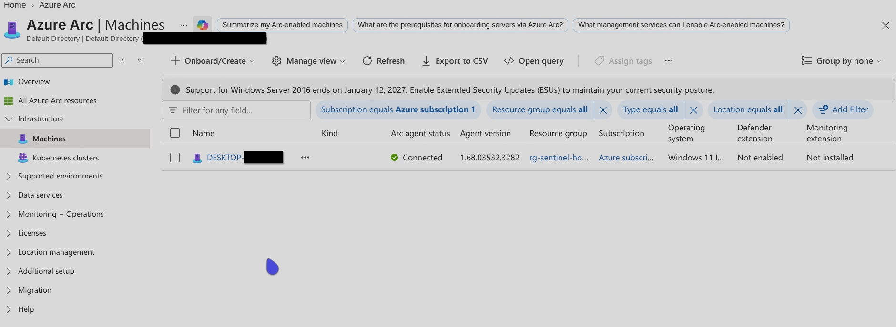

---

### Windows Security Events Solution

The Windows Security Events solution was installed from the Microsoft Sentinel Content hub.

The installed solution included the Windows Security Events via AMA data connector.

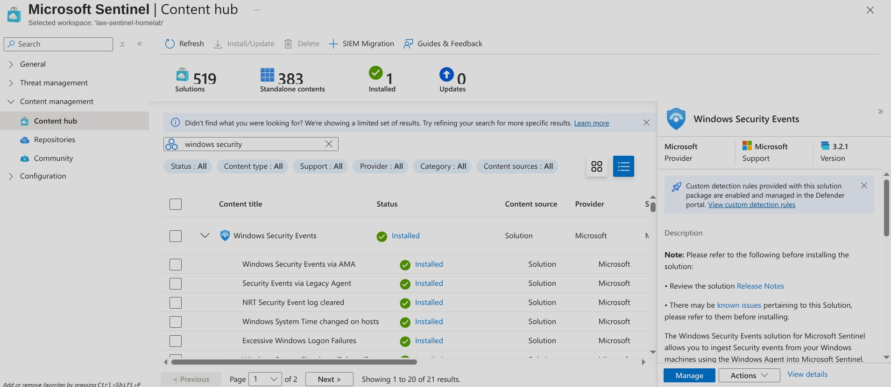

---

### Data Collection Rule

A Data Collection Rule was created and associated with the Arc-enabled Windows VM.

The rule used the Minimal Windows Security Events collection set to collect high-value events while limiting unnecessary ingestion.

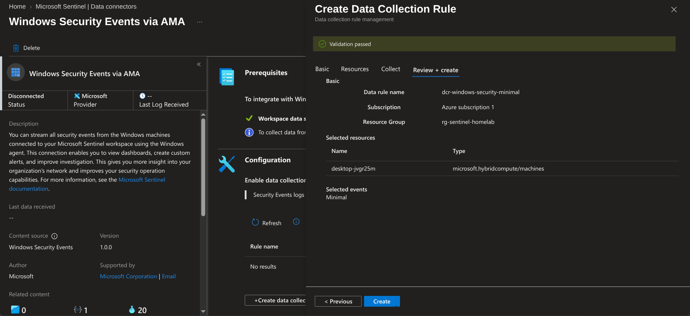

Azure Monitor Agent was installed as an extension on the Arc-enabled VM and its deployment was verified.

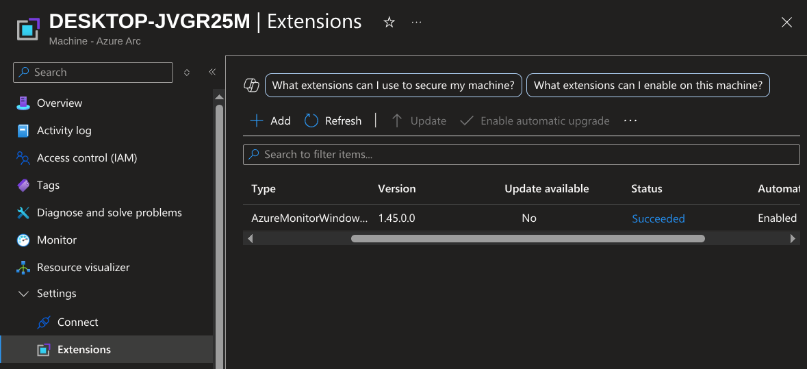

---

## KQL Validation

A controlled failed logon was generated on the Windows VM after Azure Monitor Agent and the Data Collection Rule were active.

The following KQL query was used to confirm that Windows Security events were reaching Microsoft Sentinel:

```kusto
SecurityEvent
| where TimeGenerated > ago(1h)
| where EventID in (4624, 4625, 4688)
| project TimeGenerated, Computer, EventID, Activity, Account
| order by TimeGenerated desc
```

The query returned relevant events from the monitored Windows VM:

| Event ID | Description |
| :--- | :--- |
| 4624 | Successful account logon |
| 4625 | Failed account logon |
| 4688 | New process created |

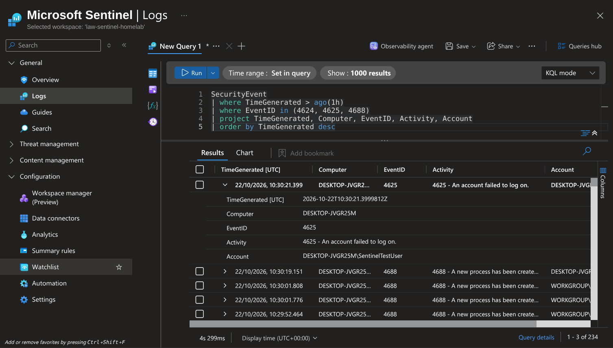

The reusable query is available here:

- [View the KQL validation query](queries/verify-security-events.kql)

---

## Result

The initial setup was successful.

The Windows VM is connected to Azure through Azure Arc, selected Windows Security events are collected through Azure Monitor Agent, and the resulting telemetry can be queried from the `SecurityEvent` table in Microsoft Sentinel.

This provides a working foundation for later projects involving:

- KQL investigations
- Threat hunting
- Custom analytics rules
- Incident generation and triage
- Detection  IPv6 connectivity checks produced warnings, but the agent successfully communicated through the available network path.
- A failed-logon test initially produced no Event ID 4625 because `runas` did not receive the supplied password. Using an explicit `COMPUTERNAME\username` format and manually entering the password produced the expected event.

Documenting these issues provides a record of the troubleshooting process rather than presenting the deployment as a problem-free installation.

---

## Cost Controls

The following measures were used to minimise the possibility of unexpected charges:

- An Azure free trial was used for the project.
- The Microsoft Sentinel 31-day trial was confirmed as active.
- Only one Log Analytics workspace was created.
- A daily ingestion cap of 0.5 GB was configured.
- The Minimal Windows Security Events collection set was selected.
- No Azure-hosted virtual machine was deployed.
- No Sentinel data lake, paid Defender plan or Logic App playbook was enabled.
- All lab resources were placed in a dedicated resource group for straightforward removal.

---

## Security and Privacy

The repository does not include:

- Azure subscription IDs
- Tenant IDs
- Workspace IDs
- Authentication or device codes
- Payment information
- Azure Arc onboarding scripts
- Azure Monitor Agent diagnostic archives
- Credentials or access tokens

Screenshots should be reviewed and redacted before publication if they expose unnecessary account or Azure identifiers.
