# Microsoft Sentinel: Failed Logon Detection and Automated Triage

This project extends my Microsoft Sentinel homelab by implementing an end-to-end detection and response workflow for repeated Windows logon failures.

The objective was to move beyond basic data ingestion and demonstrate practical SOC activities involving watchlist enrichment, KQL detection engineering, analytics-rule management, incident investigation and automated triage using Azure Logic Apps.

## Workflow

```text
Controlled failed logons
        ↓
Windows Security Event ID 4625
        ↓
Azure Monitor Agent
        ↓
Microsoft Sentinel
        ↓
Watchlist enrichment
        ↓
KQL threshold detection
        ↓
Scheduled analytics rule
        ↓
Sentinel incident
        ↓
Logic Apps triage playbook
```

---

## Project Objectives

This project demonstrates:

- Creating and querying a Microsoft Sentinel watchlist
- Enriching Windows Security events with contextual information
- Developing a KQL query to detect repeated failed logons
- Creating a scheduled analytics rule
- Mapping account and host entities
- Generating and investigating a Microsoft Sentinel incident
- Creating an Azure Logic Apps playbook
- Configuring the permissions required for Sentinel automation
- Adding automated triage guidance to a Sentinel incident
- Troubleshooting Azure Arc, Azure Monitor Agent and playbook permissions

---

## Lab Environment

| Component | Implementation |
| :--- | :--- |
| Monitored endpoint | Windows 11 virtual machine |
| Virtualisation platform | KVM/QEMU on an Arch Linux host |
| Hybrid connectivity | Azure Arc-enabled server |
| Data collection | Azure Monitor Agent |
| Event source | Windows Security log |
| SIEM | Microsoft Sentinel |
| Detection language | Kusto Query Language |
| Enrichment source | Microsoft Sentinel watchlist |
| Automation | Azure Logic Apps |
| Relevant event | Windows Security Event ID 4625 |

This project builds on the environment documented in the [initial Sentinel homelab setup](../01-initial-setup/README.md).

---

## Watchlist Creation

A Microsoft Sentinel watchlist named `Lab Accounts` was created to provide contextual information for accounts used during controlled security testing.

The watchlist uses `Account` as its search key and contains the following fields:

| Field | Purpose |
| :--- | :--- |
| `Account` | Account name used for correlation |
| `Classification` | Identifies the type of account |
| `Notes` | Provides contextual information for analysts |

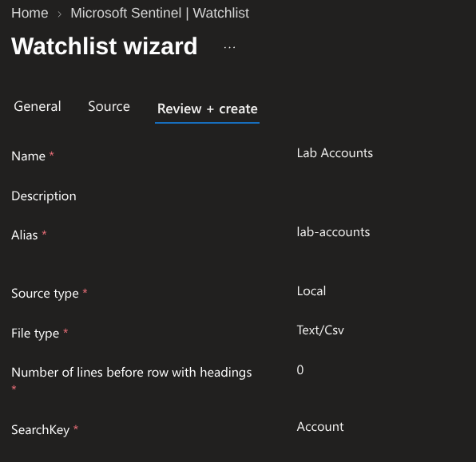

The reproducible source data is available in [`watchlists/lab-accounts.csv`](watchlists/lab-accounts.csv).

---

## Querying the Watchlist

The watchlist was queried independently to confirm that the uploaded data was available through Log Analytics.

```kusto
_GetWatchlist('lab-accounts')
| project SearchKey, Account, Classification, Notes
```

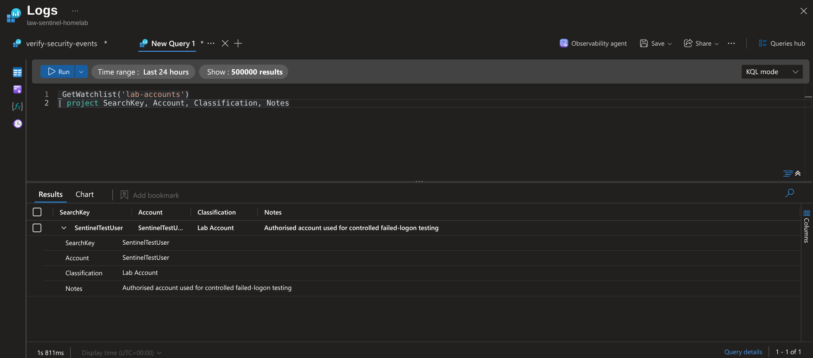

The result confirmed that `SentinelTestUser` was available as a `Lab Account`, together with notes explaining its purpose.

---

## Event Enrichment

Windows Security Event ID 4625 records failed logon activity.

The following query extracts the local account name from the full Windows account value and correlates it with the watchlist:

```kusto
let LabAccounts =
    _GetWatchlist('lab-accounts')
    | project
        WatchlistAccount = SearchKey,
        Classification,
        Notes;
SecurityEvent
| where EventID == 4625
| extend AccountName = extract(@"([^\\]+)$", 1, Account)
| lookup kind=leftouter LabAccounts
    on $left.AccountName == $right.WatchlistAccount
| project
    TimeGenerated,
    Computer,
    Account,
    AccountName,
    Classification,
    Notes,
    Activity
| order by TimeGenerated desc
```

The query returned the original Windows telemetry alongside the account classification and analyst notes imported from the watchlist.

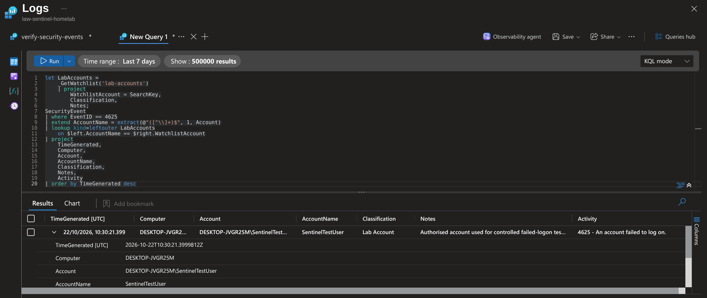

---

## Controlled Failed-Logon Activity

A temporary local account named `SentinelTestUser` was used to generate controlled failed-logon events.

The following command was run repeatedly, with an intentionally incorrect password entered at each prompt:

```cmd
runas /user:%COMPUTERNAME%\SentinelTestUser cmd.exe
```

The attempts returned Windows error 1326, indicating that the supplied username or password was incorrect.

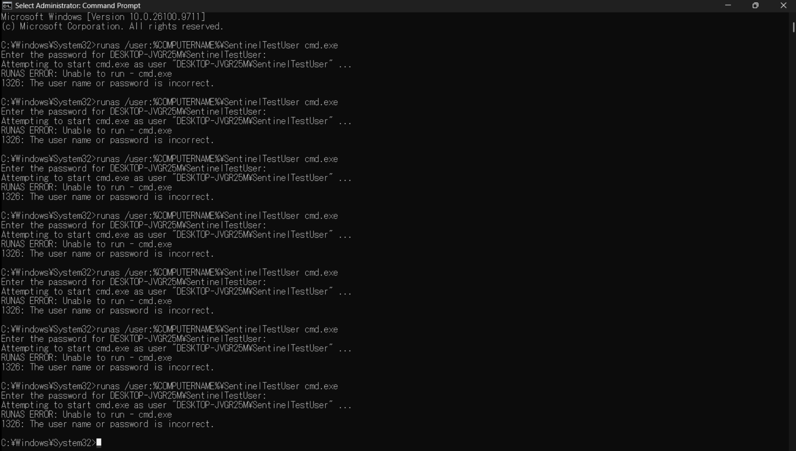

Passwords were entered interactively and were not included in the command or captured in the repository.

---

## Threshold Detection

The enrichment query was extended to detect three or more failed logons against the same account.

```kusto
let LabAccounts =
    _GetWatchlist('lab-accounts')
    | project
        WatchlistAccount = SearchKey,
        Classification,
        Notes;
SecurityEvent
| where TimeGenerated > ago(30m)
| where EventID == 4625
| extend AccountName = extract(@"([^\\]+)$", 1, Account)
| summarize
    FailedLogons = count(),
    FirstSeen = min(TimeGenerated),
    LastSeen = max(TimeGenerated)
    by AccountName, Account, Computer
| where FailedLogons >= 3
| lookup kind=leftouter LabAccounts
    on $left.AccountName == $right.WatchlistAccount
| project
    AccountName,
    Computer,
    FailedLogons,
    FirstSeen,
    LastSeen,
    Classification,
    Notes
| order by FailedLogons desc
```

The query successfully identified repeated failed logons against the monitored account and added the corresponding watchlist context.

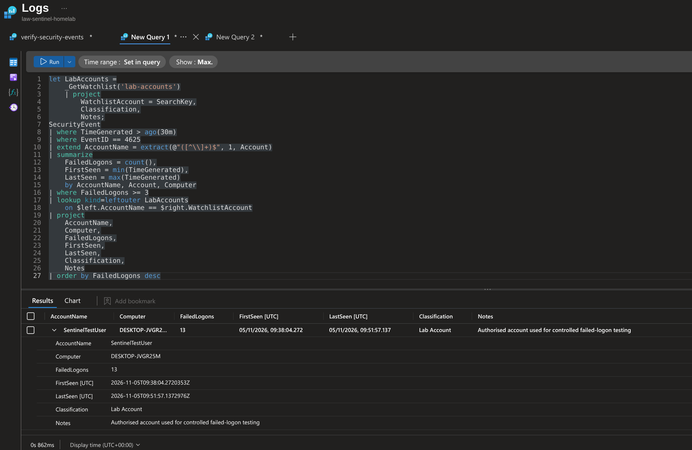

---

## Scheduled Analytics Rule

A scheduled analytics rule named `Multiple Failed Logons Against a Monitored Account` was created from the detection query.

The rule was configured with:

| Setting | Value |
| :--- | :--- |
| Severity | Medium |
| Query frequency | Every 5 minutes |
| Lookup period | 10 minutes |
| Detection threshold | Three or more failed logons |
| MITRE ATT&CK tactic | Credential Access |
| MITRE ATT&CK technique | T1110 - Brute Force |
| Incident creation | Enabled |

Account and host entity mappings were configured using `AccountName` and `Computer`.

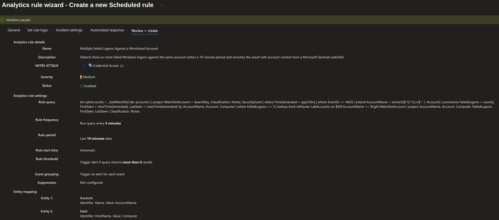

---

## Incident Generation and Investigation

Fresh failed-logon events were generated after the analytics rule was enabled.

The rule created a Microsoft Sentinel incident containing:

- Medium severity
- The monitored account entity
- The Windows host entity
- Credential Access tactic context
- The originating analytics rule
- A timeline entry for the generated alert

An investigation comment was added to document that the activity was an authorised homelab test and that no containment action was required.

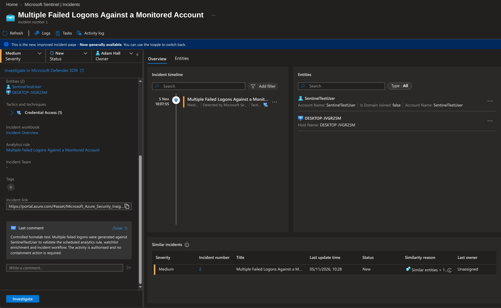

This confirmed that the KQL detection, analytics rule, incident creation and entity mappings were working together successfully.

---

## Logic Apps Playbook

An Azure Logic Apps playbook named `Add-Automated-Triage-Comment` was created with the following workflow:

```text
Microsoft Sentinel incident trigger
        ↓
Add comment to incident (V3)
```

The playbook adds the following guidance to the incident:

> Automated triage completed by the Add-Automated-Triage-Comment playbook. Review the mapped account and host entities, failed-logon count, and watchlist context before determining the appropriate response.

---

## Playbook Permissions

The workflow required separate permissions for Microsoft Sentinel and the Logic App.

### Microsoft Sentinel playbook permission

Microsoft Sentinel was granted permission to run playbooks in `rg-sentinel-homelab`.

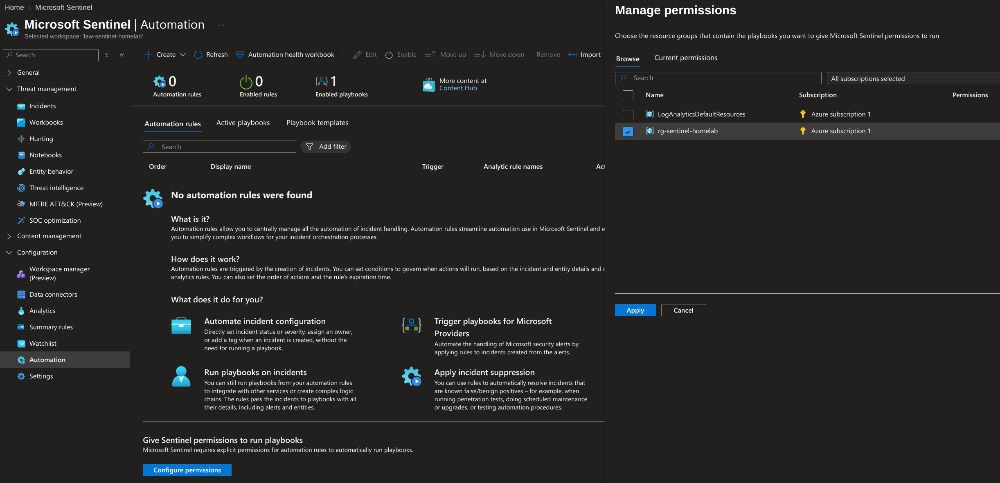

### Logic App managed identity

The Logic App managed identity was assigned the `Microsoft Sentinel Responder` role so that the playbook could add comments to Sentinel incidents.

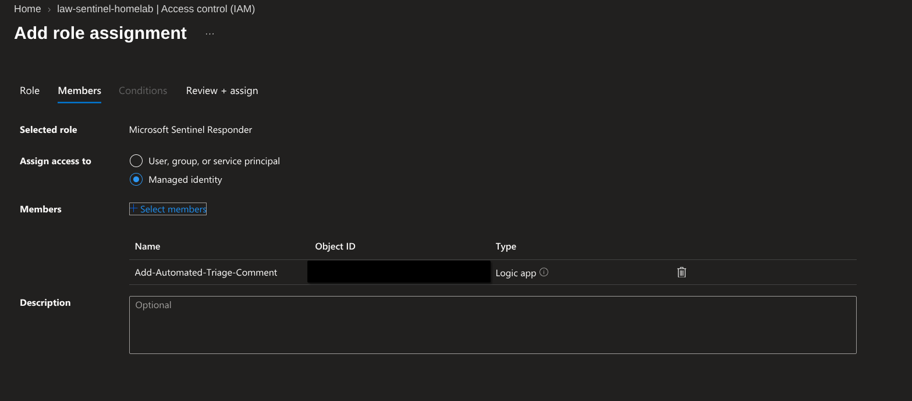

These permissions serve different purposes:

- Microsoft Sentinel requires permission to trigger playbooks in the resource group.
- The Logic App managed identity requires permission to modify the Sentinel incident.
- The user requires permission to initiate a manual playbook run.

---

## Playbook Execution

The initial playbook runs successfully received the Sentinel incident trigger but failed when attempting to add the comment.

The failed action returned HTTP 403 because the Logic App managed identity did not initially have permission to modify Sentinel incidents.

After assigning the `Microsoft Sentinel Responder` role to the managed identity, the workflow completed successfully.

The final run shows successful completion of:

- `Microsoft Sentinel incident`
- `Add comment to incident (V3)`

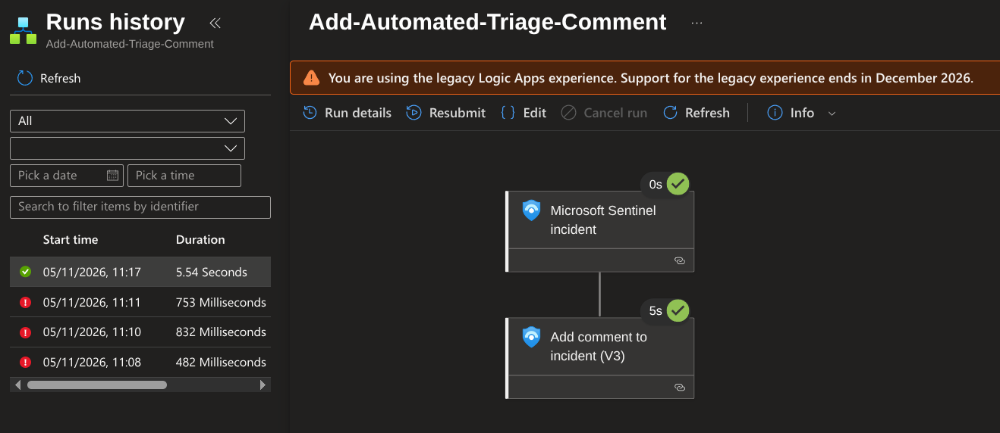

The automated triage comment was then visible directly within the generated Sentinel incident.

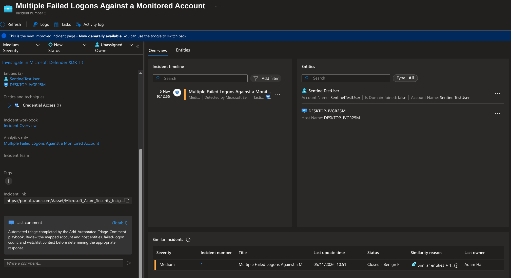

---

## Troubleshooting

Several issues were identified and resolved during the project.

### Watchlist availability delay

The watchlist was not immediately available through `_GetWatchlist()` after creation.

Waiting for the watchlist import to complete resolved the issue.

### Azure Monitor Agent ingestion after VM restart

After the virtual machine was restarted, Azure Arc appeared connected but Azure Monitor Agent heartbeat and `SecurityEvent` ingestion stopped.

The Azure Hybrid Instance Metadata Service was restarted with:

```powershell
Restart-Service himds -Force
```

After allowing time for the Arc identity and Azure Monitor Agent connection to recover, heartbeat and security-event ingestion resumed.

### Missing Data Collection Rule configuration

During troubleshooting, Azure Monitor Agent was running but its local Data Collection Rule configuration files were missing.

The Arc machine was reconnected and associated with the existing Data Collection Rule. Azure Monitor Agent then received its collection configuration and resumed sending data.

### Playbook trigger permission

The playbook initially could not be triggered because Microsoft Sentinel had not been granted permission to run playbooks in the resource group.

This was resolved through:

```text
Microsoft Sentinel
→ Automation
→ Configure permissions
→ rg-sentinel-homelab
```

### Incident comment permission

The incident trigger subsequently succeeded, but the comment action returned HTTP 403 Forbidden.

The Logic App managed identity was assigned the `Microsoft Sentinel Responder` role on the Sentinel workspace. The next workflow execution completed successfully and added the automated comment.

This troubleshooting provided practical experience distinguishing between:

- User permissions
- Microsoft Sentinel service permissions
- Logic App managed-identity permissions
- Azure Arc connectivity
- Azure Monitor Agent health
- Data Collection Rule associations

---

## Result

The project successfully implemented an end-to-end Sentinel detection and automated triage workflow.

The completed solution:

- Collected failed Windows logons through Azure Monitor Agent
- Enriched events with account context from a Sentinel watchlist
- Detected repeated failures using KQL
- Generated alerts and incidents through a scheduled analytics rule
- Mapped account and host entities for investigation
- Used an Azure Logic Apps playbook to add automated triage guidance
- Demonstrated successful incident enrichment and response automation
- Documented the troubleshooting required to restore ingestion and configure SOAR permissions

This project provides practical evidence of working with Microsoft Sentinel as both a SIEM and SOAR platform.
